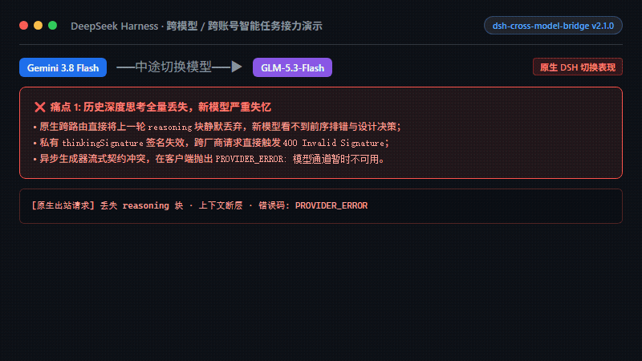

# dsh-cross-model-bridge

<p align="center">
  
  
  
  
</p>

> **Seamless Cross-Model & Multi-Account Thinking Handoff Bridge for DeepSeek Harness (DSH)**
>
> DeepSeek Harness 跨模型 / 跨账号智能任务接力桥（v2.1.1 工业级版）—— 在同一个 Agent 会话中切换模型或轮换账号时，自动剥离不兼容的私有签名并安全传递历史思考过程，防止 `400` / `PROVIDER_ERROR` 崩溃与上下文断层。

---

## 为什么需要这个插件？

在 DeepSeek Harness（DSH）中，长对话中途切换模型（例如强推理模型做架构规划 → 快速模型写代码）或额度耗尽时同模型换账号，原生机制通常会遇到以下问题：

| 场景痛点 | 原生 DSH 行为 | 安装 `dsh-cross-model-bridge` 后 |
| :--- | :--- | :--- |
| **历史思考过程丢失** | 切换路由时上一轮 `reasoning` 块被静默丢弃，新模型“失忆” | **三段式结构化抽取**关键推演（首 15% + 锚点 25% + 尾 60%），降维注入为标准化 XML 上下文 |
| **跨厂商/换号崩溃** | 透传私有 `reasoning` 块或 `thinkingSignature` 触发 `400` / `PROVIDER_ERROR` | 出站自动剥离私有块与签名，并以规范 `async function*` + `return yield*` 异步流式委派彻底防崩 |
| **连续切换上下文膨胀** | 多轮切换后反复拼接导致历史提示词套娃、破坏 Markdown 代码块 | **多跳幂等清洗**旧 handoff 块，配备**代码块围栏防护**（绝不腰斩反引号）与双语 Token 预算控制 |
| **Prompt Cache 失效** | 修改顶层 `system` 提示词会直接打断前缀 KV Cache，首字延迟（TTFT）与费用飙升 | **绝不修改顶层 `system` / `developer` 消息**，交接块精准挂载在最新 User 边界，最大程度保留缓存命中 |
| **429 限流/中断脏状态** | 流式报错时状态已提前写入，重试接棒错乱 | **两阶段安全提交**（`prepareRequest` → `commitResponse`），遇到限流重试无污染 |

---

## 效果预览

<p align="center">
  
</p>

*演示动效使用 Remotion 规范架构制作（源码见 [`assets/remotion/`](assets/remotion)），直观展示原生报错丢弃到智能三段式接力、KV Cache 保护与新模型无缝承接全过程。*

---

## 核心机制（v2.1.0）

插件基于 DeepSeek Harness 的 **Cordis** 插件体系，通过 `ctx.on('llm/stream', ...)` 在出站流式请求前完成无侵入改写，并通过内置 `client.js` 提供可视化监控面板：

1. **双场景路由判定**：对比历史 `assistant` 消息的源路由与当前目标 `provider` / `model`，自动区分**同模型换账号**（额度耗尽无感轮转）与**跨模型切换**两种接力模式。
2. **阶段一：三段式结构化思维预算抽取（`prepareRequest`）**
   * **首部 15%**：锁定前序初始核心任务目标与技术约定约束。
   * **中部 25%**：正则提炼排错与决策锚点句（排除、放弃、必须、最终结论等），自动与同轮可见正文去重。
   * **尾部 60%**：保留末尾关键推演收敛证据，中部剩余预算自动全额回流至尾部。
   * **安全边界处理**：代码块安全围栏防护（支持 ```` ``` ```` 与 `~~~`，切点落在代码块内时自动规避，反引号必成对闭合）、语义标点/换行吸附，以及中英双语权重估算（ASCII `0.25` / 非 ASCII 汉字 `1.0`）。
3. **Prompt Cache 友好与防套娃 XML 协议**
   * 仅通过 `<internal_handoff data-dsh-bridge="1" from="..." mode="...">...</internal_handoff>` 注入接力上下文，**绝不改动顶层 `system` / `developer` 消息**。
   * 自动幂等清洗更早轮次的旧 handoff 标签，避免连续切换（A → B → C）产生嵌套套娃。
   * 接棒块固定挂在切换点之后的第一条 User 消息上，在 `keepThinkingTurns` 个真实用户轮次内位置与内容保持不变（前缀字节稳定）；窗口过后不再注入，但跨路由消息里的私有推理仍持续剥离。仅处理来源路由与目标不同（或来源未知）的 `assistant` 消息，目标模型自己的 thinking / 签名原样保留。
   * 保护 Agent 工具调用链，避免破坏 `tool_use` 与 `tool_result` 的紧邻关系；剥离思考块后若消息变空，自动补入 `(continued)` 兜底防止 400 校验报错。
   * 全面兼容非数组推理字段（支持顶层 `reasoning_content`、`reasoning_details` 与 `type: 'thinking'`）。
4. **阶段二：规范流式委派与安全提交（`commitResponse`）**
   * 使用 `async function*` 与 `yield*` 规范委派底层 `AsyncIterable` 流，彻底根治此前返回裸 Promise 引发的 `PROVIDER_ERROR`。
   * 仅在流式响应安全完成后提交状态并以临时文件 `.tmp` 原子替换落盘至 `.bridge-events.json`，遇到 429 限流或超时重试时不会污染接棒状态。
5. **内置监控面板（`client.js`）**
   * 提供右侧栏与主视图双入口，通过 `GET /plugins/dsh-cross-model-bridge/events` 实时展示接力事件、三段式提取标签、源/目标路由与 Token 预估。
   * 物理吸顶状态栏、一键回顶最新记录，并支持 `document.hidden` 页面不可见时自动暂停轮询节流。

---

## 快速安装

### 环境要求

* Windows + DeepSeek Harness (DSH Desktop)
* Node.js `>= 22`

### 安装步骤

```powershell
# 1. 克隆仓库
git clone https://github.com/ZhangJinHui0627/dsh-cross-model-bridge.git
cd dsh-cross-model-bridge

# 2. 部署安装至 DSH Desktop Profile（无侵入式 Junction 软链接）
pwsh -File install-profile.ps1
```

> 也可以直接双击或运行根目录下的 `install.cmd` 完成安装。

### 生效方式

* **前端监控面板热更新**：在 DeepSeek Harness 窗口中按 `Ctrl + R` 即可即时加载。
* **后端流式拦截器生效**：完全退出并重新启动 DeepSeek Harness 客户端。

### 卸载

```powershell
pwsh -File install-profile.ps1 -Uninstall
```

---

## 配置说明（`cordis.patch.yml`）

插件支持通过 `cordis.patch.yml`（或配置界面）调整思维抽取预算、比例分配与保留窗口。插件初始化时会自动对比例进行**归一化校验**，并设置安全下限：

| 配置项 | 默认值 | 说明 |
| :--- | :--- | :--- |
| `enabled` | `true` | 插件总开关 |
| `maxThinkingTokens` | `500` | 思考链三段式抽取的 Token 预算上限（下限兜底 $\ge 50$） |
| `headRatio` | `0.15` | 首部初始目标预算占比（三者之和自动归一化为 1.0） |
| `midRatio` | `0.25` | 中部决策锚点预算占比 |
| `tailRatio` | `0.60` | 尾部收敛推演预算占比（中部未用完预算自动回流） |
| `asciiWeight` | `0.25` | ASCII 字符 Token 估算权重 |
| `nonAsciiWeight` | `1.0` | 非 ASCII 字符（汉字 / 全角）Token 估算权重 |
| `keepThinkingTurns` | `1` | 切换后携带接棒块的真实用户轮次数，超出后不再注入（跨路由消息的私有推理仍持续剥离）；`0` 表示永不注入、只做剥离 |
| `lang` | `'zh'` | 接棒协议提示语言（支持 `'zh'` / `'en'`） |

示例配置片段：

```yaml
dsh-cross-model-bridge:
  enabled: true
  maxThinkingTokens: 500
  headRatio: 0.15
  midRatio: 0.25
  tailRatio: 0.60
  asciiWeight: 0.25
  nonAsciiWeight: 1.0
  keepThinkingTurns: 1
  lang: zh
```

---

## 模型兼容性矩阵

| 切换场景 / 模型组合 | 状态 | 说明 |
| :--- | :--- | :--- |
| **同模型跨账号轮换**<br>(同一模型不同 Provider/Key) | ✅ 支持 | 触发同模型换账号接棒模式，继承决策目标 |
| **主流跨厂商切换**<br>(DeepSeek / Gemini / Claude / GLM 等) | ✅ 支持 | 自动剥离私有签名，三段式证据注入，严格保住 System KV Cache |
| **带 Agent 工具链调用**<br>(Tool Call / Function Call) | ✅ 支持 | 挂载在最后一个 `tool_result` 之后，绝不破坏工具链配对 |
| **第三方聚合中转站 / 新推理模型** | ✅ 支持 | 兼容顶层 `reasoning_content` 与 `reasoning_details`，空消息自动补 `(continued)` |

---

## 项目结构

```text
├── lib/
│   ├── config.js        # 配置自动归一化与安全边界校验
│   ├── extractor.js     # 三段式思维预算抽取引擎、代码块安全围栏防护、标点吸附与 Token 估算
│   ├── protocol.js      # XML 接力协议构建、多跳防套娃清洗、非数组推理字段兼容与工具链保护
│   └── store.js         # 本地事件 FIFO 环形缓冲持久化与 .tmp 原子落盘
├── tests/
│   └── bridge.test.mjs  # Node.js >= 22 原生单元测试套件（覆盖代码块、防套娃与工具链等关键边界）
├── assets/
│   ├── preview.gif      # 效果预览动图
│   └── remotion/        # Remotion 动画规范源码工程（Root.tsx, CrossModelDemo.tsx）
├── index.js             # 插件入口：Cordis 瀑布流拦截器、异步生成器委派与数据路由
├── client.js            # DSH 前端监控面板（右侧栏与主视图双入口、吸顶状态栏、Session 过滤、后台休眠）
├── package.json         # 插件清单与 NPM Scripts
├── cordis.patch.yml     # Cordis 插件配置声明
├── install-profile.ps1  # PowerShell 部署与卸载脚本（Junction 无侵入安装）
├── install.cmd          # Windows 一键安装脚本
└── README.md            # 项目主文档
```

---

## 运行测试

使用 Node.js >= 22 原生测试运行器直接执行：

```powershell
npm test
```

---

## 致谢

* 基于 [DeepSeek Harness](https://github.com/deepseek-ai) 官方插件体系与 [Cordis](https://cordis.moe) 服务发现框架构建。
* 特别感谢《**DeepSeek Harness 跨模型插件客观评价**》（含 30 页深度分析与参考代码）对本插件提出的中肯评测、三段式结构化思维抽取算法、Prompt Cache 保护思路及防套娃清洗机制。
* 动效预览基于 [Remotion](https://github.com/remotion-dev/remotion) 规范与动效原理制作。
* 参考借鉴了官方插件 `dsh-session-checkpoint-policy` 的流式拦截改写模式与 `dsh-codex-effort-slider` 的无侵入式 Junction 部署方式。

---

## License

[MIT](LICENSE)
